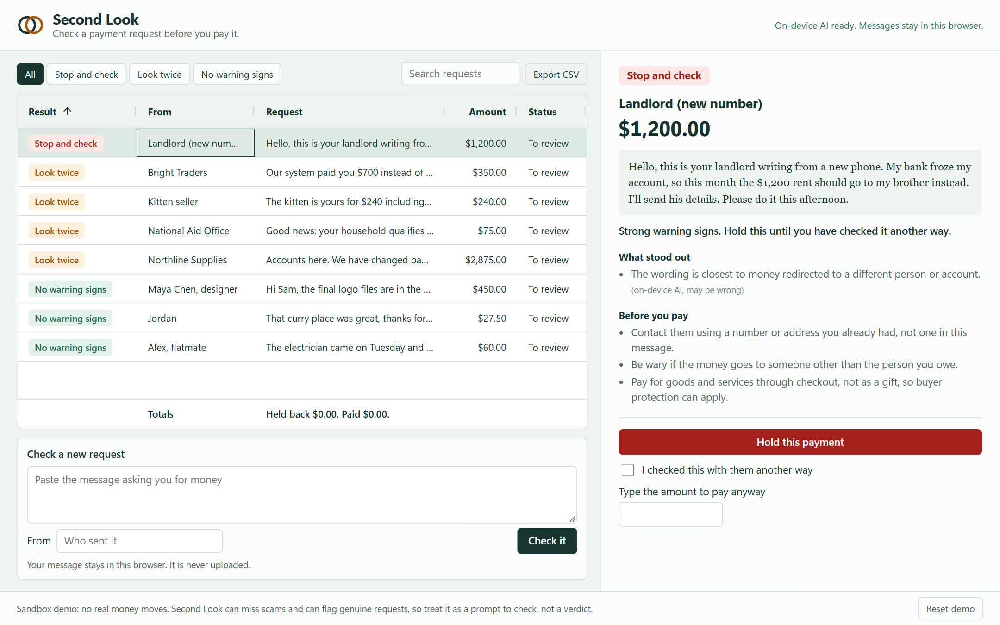

# Second Look

Check a payment request before you pay it.

Second Look is a payment inbox. Each request is checked in your browser, and the riskier it looks, the more you have to do before the PayPal button appears. You can also hold a payment and see how much you've held back.



**Try it:** https://zuhairhalawa.github.io/second-look/

Runs in the PayPal sandbox, so no real money moves.

## How it works

| Result | What you see | Before you can pay |
| --- | --- | --- |
| No warning signs | Nothing stood out. This can't prove a request is genuine. | Nothing extra |
| Look twice | What looks off, and how to check it | Tick "I checked this with them another way" |
| Stop and check | The same, in stronger terms | Tick the box and type the exact amount |

Nothing can be paid while a check is still running.

Each message gets two checks:

1. **Rules** look for known warning signs, such as gift cards or pressure to hurry.
2. **On-device AI** turns the message into a sentence embedding with [all-MiniLM-L6-v2](https://huggingface.co/Xenova/all-MiniLM-L6-v2) and compares it to a small labelled library of scam patterns and normal requests in [`src/exemplars.js`](src/exemplars.js). This catches rewordings that rules miss. It also names the closest pattern, marked "may be wrong", because that label is only the nearest match.

If the model can't load, the app says so and uses the rules alone.

## What leaves your browser

Your messages don't. The model runs in a Web Worker, and an automated browser test logged every request while a message was pasted and checked: none contained any of its text.

The app does make these requests:

- The AI library comes from jsDelivr and the model from Hugging Face, once, and the browser then caches them.
- If you open PayPal checkout, PayPal receives the amount and a fixed description. It doesn't receive the message or the sender's name.

Requests you add and their status are stored in your browser's `localStorage`. **Reset demo** clears them.

## How accurate is it

These are small, made-up, English-only test sets, so treat this as a sanity check and not a real-world rate.

| On 15 scams and 15 genuine requests the app never learned from | Scams caught | False alarms |
| --- | --- | --- |
| Rules alone | 2 of 15 | 0 of 15 |
| AI alone | 11 of 15 | 0 of 15 |
| Second Look (both) | 11 of 15 | 0 of 15 |

It missed a tax refund fee, an apartment deposit, a car warranty threat and an overpayment to a mover, so **it will miss real scams**. It's a prompt to check, not a verdict.

The threshold was chosen on the library alone, using leave-one-out (30 of 36 scam examples caught, 4 of 24 normal examples flagged). Then it was scored once on the held-out set. Two other approaches were tried first and rejected: zero-shot classification with two different models gave too many false alarms.

Run it yourself at [`/eval/`](eval/index.html), which uses the same code as the app. Results are in [`eval/results.json`](eval/results.json).

## PayPal integration

- Uses the [PayPal JavaScript SDK](https://developer.paypal.com/sdk/js/reference/) with Buttons, `actions.order.create` and `actions.order.capture`.
- A payment only counts as paid when the order and its capture both come back `COMPLETED`. The capture ID is then shown on the request. A `PENDING` capture is shown as pending and doesn't count toward the paid total.
- If the SDK can't capture because it has no buyer token, which happened in one browser during testing, the app captures through the Orders REST API with the token PayPal issued for that order. This path has unit tests but hasn't yet run against PayPal. A full sandbox payment has completed through the SDK's own capture.
- In this demo, payments go to the sandbox merchant account that owns the client ID. A real product would pay the person who sent the request.
- The app has no server and needs no secret. The client ID in `config.js` is public by design. Never put a client secret in this repo.

## Run it locally

You need Node.js, for the test runner and a static server.

```bash
git clone https://github.com/zuhairhalawa/second-look.git
cd second-look
npx http-server . -p 8077 -c-1
```

Open http://localhost:8077. To use your own sandbox account, create an app at [developer.paypal.com](https://developer.paypal.com) and put its sandbox client ID in `config.js`.

```bash
npm test
```

## Built with

- [PayPal JavaScript SDK](https://developer.paypal.com/sdk/js/reference/), sandbox
- [AG Grid Community](https://www.ag-grid.com/) 36.3.0 (MIT): the inbox table, sorting, filtering, quick search, pinned totals row and CSV export
- [Transformers.js](https://github.com/huggingface/transformers.js) 4.3.2 (Apache-2.0), running on WebAssembly
- [all-MiniLM-L6-v2](https://huggingface.co/sentence-transformers/all-MiniLM-L6-v2) (Apache-2.0), quantized, 23 MB

## License

[MIT](LICENSE). AG Grid's own license is in [`vendor/AG-GRID-LICENSE.txt`](vendor/AG-GRID-LICENSE.txt).
